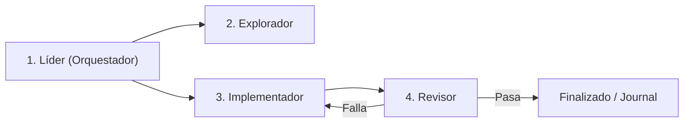

# Skill: Metodología de Arneses Agénticos (`f-harness-workflow` v2.2)
## Harness Engineering, Desacoplamiento de Roles & Verificación Determinista

> **Propósito**: Proveer un marco sistemático para orquestar tareas de alta complejidad técnica mediante subagentes desacoplados, aislamiento de pruebas y certificación estricta por evidencia antes de afirmar.

---

## 🎯 1. Menú Interactivo Menu-First

Al invocar `/f-harness`, `/harness` o solicitar estructurar un flujo de arnés, el agente **DEBE responder presentando este menú interactivo**:

```markdown
╔═══════════════════════════════════════════════════════════════╗
║       🛸 F-HARNESS-WORKFLOW — INGENIERÍA DE ARNESES           ║
╚═══════════════════════════════════════════════════════════════╝

Selecciona una acción respondiendo con el **número** correspondiente:

1️⃣ **Inicializar Arnés de Trabajo para Tarea Compleja**
   ↳ Ejecuta `SCRIPTS/init_harness.sh`, establece el checkpoint y genera la matriz de tareas desacopladas.

2️⃣ **Despachar Fase Explorador (AST & Ground Truth)**
   ↳ Rastrea dependencias en Graphify AST (Nivel 0) y consulta cuadernos de NotebookLM sin alterar archivos de producción.

3️⃣ **Despachar Fase Implementador (TDD & Safe Modification)**
   ↳ Aplica cambios incrementales con tests unitarios y ejecución en arena segura (`SCRIPTS/safe_run_python.sh`).

4️⃣ **Despachar Fase Revisor & Certificación E5**
   ↳ Ejecuta linters, aserciones remotas (`SCRIPTS/qa_assertions.js`) y valida la Regla del Único Certificador.

5️⃣ **Consultar Matriz de Enrutamiento de Modelos**
   ↳ Muestra la asignación de modelos por tier (Trivial, Estándar, Arquitectura) en `SCRIPTS/model_router.md`.

6️⃣ **Diagnóstico Rápido de Motores & Estado del Arnés**
   ↳ Invoca `SCRIPTS/harness_doctor.py` para verificar que los modelos seleccionados para cada rol están vivos y el proxy responde antes de despachar subagentes.

7️⃣ 🐝 **Auditoría con Enjambre Anclado & Falsabilidad Ejecutable**
   ↳ Ejecuta deliberación multi-motor inyectando código con números de línea (`python3 SCRIPTS/harness_dispatch.py --swarm --file <ruta>`), exigiendo citas de líneas y oráculo ejecutable (tests de reproducción).

0️⃣ **Salir**
```

---

## 🔄 2. Los 4 Roles del Ciclo de Vida Agéntico



1. **Líder (Orquestador)**:
   - Lee el estado del Memory Bank y la cola de tareas.
   - Despacha subagentes con contexto quirúrgico (sin historiales masivos de chat).
2. **Explorador**:
   - Investiga código, busca en Graphify AST (`graphify query`) o consulta NotebookLM.
   - Escribe artefactos de análisis directamente en disco (`brain/` o `scratch/`).
3. **Implementador**:
   - Modifica código, escribe tests unitarios y mantiene actualizado el estado de la tarea.
4. **Revisor (Reviewer)**:
   - Ejecuta scripts deterministas de verificación (`skill_lint.py`, `qa_assertions.js`, tests).
   - Valida convenciones de arquitectura y lecciones aprendidas (`lessons-learned.md`).
   - Aprueba o rechaza con evidencia objetiva (exit codes, aserciones, hashes visuales).

---

## 🛡️ 3. Reglas Inmutables de Verificación (Evidencia antes de Afirmar)

1. **Evidencia antes de Afirmar**: Prohibido declarar "resuelto" o "completado" sin haber ejecutado la prueba técnica y confirmado su salida exitosa (`exit 0`).
2. **Aislamiento de Causa Raíz**: En debugging, reproducir el fallo con una prueba mínima antes de modificar el código de producción.
3. **Regla del Único Certificador**:
   - Citar siempre:
     1. Ruta del screenshot (`.png`) o salida de test inspeccionada.
     2. SHA256 criptográfico del artefacto.
     3. JSON de aserciones (`pass: true`).
4. **Prueba de Humo Obligatoria en Mutaciones de Configuración**: Toda modificación en archivos de configuración (`settings.yaml`, `harness_mode.json`, servicios, pipelines) exige prueba de humo determinista inmediata (`dsh --dump-config`, `harness_doctor.py`, tests unitarios) antes de dar por cerrada la tarea.
5. **Escritura Segura de Archivos (Anti-Volcado Masivo)**: Prohibido volcar archivos o documentos extensos (>15-20 KB o >300 líneas) en una sola llamada de herramienta (`write_to_file` con payloads gigantes). Para prevenir la saturación de buffers IPC/SSE y errores de stream interrumpido, los archivos largos deben generarse por partes incrementales, modificarse quirúrgicamente o escribirse mediante scripts locales directos en Python o Bash.

---

## 🔄 4. Compatibilidad Multi-Agente

| Agente | Soporte | Notas |
|---|:---:|---|
| **Antigravity IDE** | ✅ Completo | Subagentes nativos como roles desacoplados |
| **OpenCode CLI** | ✅ Completo | Menú en texto, ejecución secuencial de fases |
| **Hermes CLI** | ✅ Completo | Menú en texto, ejecución secuencial de fases |
| **Modo Degradado** | — | Sin subagentes, ejecutar roles en secuencia dentro de la misma sesión |
