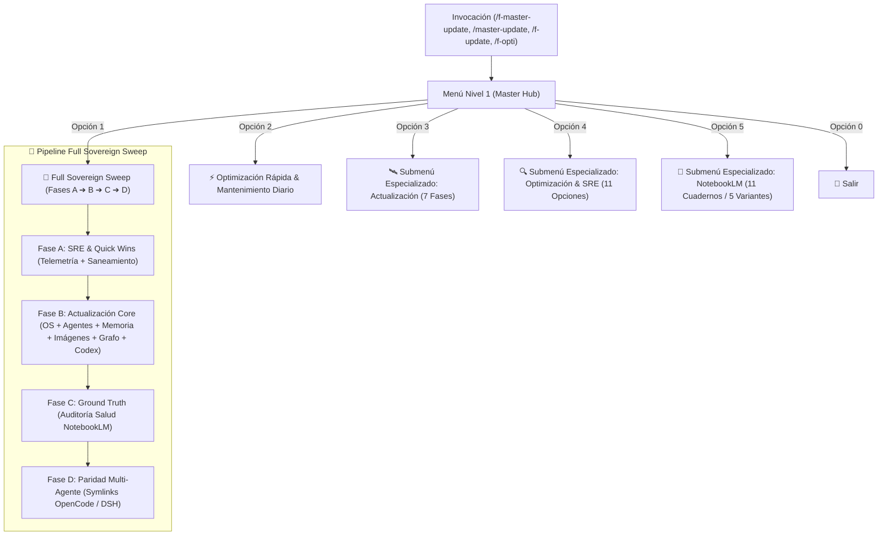

# Super Skill: Master Update & SRE Sovereign Governor (`f-master-update` v1.0)

> **Propósito**: Super suite canónica unificada del Ecosistema FloydIA bajo el **Protocolo v28**. Centraliza en un único punto de entrada con arquitectura **Menu-First en 2 niveles** las tres suites maestras:
> 1. **`f-update-floydia` v5.3**: Actualización determinista bare-metal (OS APT, Flatpaks, firmware, NPM agents, Memory Bank, catálogo semántico de imágenes, Graphify AST, CODEX_FLOYDIA y smoke tests).
> 2. **`f-opti-floydia` v4.1**: SRE Governor, sonda de telemetría, saneamiento de temporales, rescate anti-hang seguro, análisis de cuellos de botella y resiliencia de backups.
> 3. **`f-opti-notebooklm` v1.1**: Curación soberana, auditoría y enrutamiento de los 11 cuadernos de la base de verdad Google NotebookLM.

---

## 🧭 1. Arquitectura Unificada & Flujo de Ejecución



---

## 🎯 2. Menú Interactivo Nivel 1 — Master Hub

Al invocar `/f-master-update`, `/master-update`, `/f-update`, `/f-opti`, `/actualizar-todo` o `/super-update`, el agente **DEBE responder de inmediato presentando este menú Bento interactivo**:

```markdown
╔════════════════════════════════════════════════════════════════════════════════╗
║             ⚡ F-MASTER-UPDATE — MASTER SRE & UPDATE HUB v1.0.0               ║
║                     Ecosistema FloydIA — Protocolo v28                         ║
╚════════════════════════════════════════════════════════════════════════════════╝

Selecciona una acción respondiendo con el número correspondiente:

1️⃣ 🚀 **Suite Completa Soberana (Full Sovereign Sweep)**
   ↳ Pipeline de 4 Fases Integradas:
     • Fase A: Telemetría SRE + Quick Wins seguras (purga zombies, temporales).
     • Fase B: Actualización OS (APT/Flatpak/NPM), Memory Bank, Catálogo Visual de Imágenes,
       Graphify AST y regeneración de CODEX_FLOYDIA.md.
     • Fase C: Auditoría de integridad y salud de los 11 cuadernos NotebookLM.
     • Fase D: Sincronización multi-agente (`sync_skills_multiagent.sh --fix`).

2️⃣ ⚡ **Optimización Rápida & Mantenimiento Diario (Quick Wins)**
   ↳ Saneamiento seguro de temporales (`antigravity_speed_boost.sh`), purga de procesos
     huérfanos, compactación de memoria (`memory_compactor.py`) y comprobación rápida
     de paquetes actualizables sin reinicio.

3️⃣ 🛰️ **Submenú Especializado de Actualización (f-update-floydia v5.3)**
   ↳ Despliega las 7 fases granulares de actualización de sistema, imágenes y manifiestos.

4️⃣ 🔍 **Submenú Especializado de Optimización & SRE (f-opti-floydia v4.1)**
   ↳ Despliega las 11 opciones de auditoría hardware/red, prompts duales y rescate anti-hang.

5️⃣ 🧠 **Submenú Especializado de NotebookLM (f-opti-notebooklm v1.1)**
   ↳ Despliega el selector de los 11 cuadernos activos y las 5 variantes de curación.

0️⃣ 🚪 **Salir**
```

---

## 📂 3. Submenús Especializados (Nivel 2)

### 🛰️ Submenú 3: Actualización & Disaster Recovery (`f-update-floydia`)
```markdown
╔═══════════════════════════════════════════════════════════════╗
║         🛰️ SUBMENÚ: ACTUALIZACIÓN & DISASTER RECOVERY         ║
╚═══════════════════════════════════════════════════════════════╝

1️⃣ **Actualización Completa (Full Pipeline Fases 0 a 7)**
   ↳ Preflight, OS/APT/Flatpak/NPM, Memoria, Catálogo Imágenes, Grafo AST, CODEX, Smoke Tests y Sync.
2️⃣ **Catálogo Visual & Metadatos Semánticos de Imágenes** 📸
   ↳ Ejecuta `index_workspace_images.py` en paralelo (dimensiones, DPI, ratios, ALT text y JSON).
3️⃣ **Compactación del Memory Bank & Auditoría Syncthing**
   ↳ Lock exclusivo `memory_compactor.py`, verificación de budget (≤400 tokens) y escaneo `.sync-conflict`.
4️⃣ **Auditoría de Sistema, Paquetes & Agentes IA (MX Linux / APT / Flatpak / DSH / OpenCode)**
   ↳ Detección con `apt list --upgradable`, paquetes globales NPM y firmware sin cambios destructivos.
5️⃣ **Reconstrucción del Grafo AST (Graphify) & Manifiesto CODEX**
   ↳ `graphify update .` y regeneración determinista de `CODEX_FLOYDIA.md`.
6️⃣ **Smoke Tests & Certificación Rápida**
   ↳ `dpkg --configure -a`, `dsh --dump-config`, latencia Graphify <10ms y consistencia.
7️⃣ **Sincronización Multi-Agente (OpenCode Desktop, DeepSeek Harness)**
   ↳ `sync_skills_multiagent.sh --fix` asegurando paridad del 100% en la trinidad agéntica.
0️⃣ **Volver al Menú Principal**
```

### 🔍 Submenú 4: Optimización & SRE Governor (`f-opti-floydia`)
```markdown
╔═══════════════════════════════════════════════════════════════╗
║         🔍 SUBMENÚ: OPTIMIZACIÓN & SRE GOVERNOR               ║
╚═══════════════════════════════════════════════════════════════╝

1️⃣ **Diagnóstico Completo del Ecosistema** (`ecosystem_probe.py`: CPU, RAM, ZRAM, CT114, CT106, MikroTik).
2️⃣ **Generar Prompts Duales para IA Web** (Prompt A Telemetría Sanitizada + Prompt B Plan de Acción SRE).
3️⃣ **Optimización Rápida (Quick Wins Seguras)** (Saneamiento de temporales y procesos huérfanos).
4️⃣ **Consultar Ground Truth** (`graphify_query.sh` por lotes + NotebookLM + Obsidian).
5️⃣ **Auditoría de Red, MikroTik & APIs de IA** (Latencias TCP CT114 :3000, CT106 :8384, DNS AI).
6️⃣ **Rescate de Emergencia Anti-Hang (< 1s)** (`kill_hung_agents.sh` con lista blanca estricta).
7️⃣ **Diagnóstico de Cuellos de Botella & Errores** (`bottleneck_analyzer.py`: dmesg, I/O wait, throttling, PSI).
8️⃣ **Auditoría de Agentes & Harness Engineering** (`agent_health_check.py`: paridad symlinks, MCPs, logs).
9️⃣ **Mapa Mental / Infograma del Ecosistema** (Mermaid completo y prompt infograma premium).
🔟 **Escaneo de Prompts Históricos & Enriquecimiento** (Inventario `memory-bank/prompts/` CAT_01..08).
1️⃣1️⃣ **Resiliencia & Continuidad SRE** (Verificar manifest SHA256, log OK, crons y `guard_command.py`).
0️⃣ **Volver al Menú Principal**
```

### 🧠 Submenú 5: Base de Verdad NotebookLM (`f-opti-notebooklm`)
```markdown
╔═══════════════════════════════════════════════════════════════╗
║         🧠 SUBMENÚ: CURADOR SOBERANO NOTEBOOKLM               ║
╚═══════════════════════════════════════════════════════════════╝

📚 **Cuadernos Activos:**
[0] Todos (11) | [1] BEE_IoT | [2] BRANDING | [3] PROJECT_GAMMA | [4] STITCH2ELEMENTOR
[5] ARQ_WEB_SCRAPING | [6] LINUX_PROXMOX | [7] MIKROTIK | [8] FLOYDIA_SUITE_MASTER
[9] CLIENTES_Y_NEGOCIOS | [10] AGENTS_HARNESS_ENGINEERING | [11] CREATIVE_WEB_AI_ANIMATIONS

⚙️ **Variantes de Curación:**
1️⃣ Búsqueda y Adición de Fuentes Nuevas
2️⃣ Enriquecimiento desde Transcripts & Journals (`memory-bank/journal/`)
3️⃣ Generación de Informes y Resúmenes SSOT para Memory Bank
4️⃣ Auditoría de Integridad, Salud & Cobertura (`notebooklm_curator.py --health`)
5️⃣ Pipeline Completo (Full Auto-Opti)
0️⃣ Volver al Menú Principal
*(Responde con: [Cuaderno] [Variante], ej. '0 4' o '6 2')*
```

---

## 🛠️ 4. Matriz de Comandos CLI y Scripts Operativos

| Suite / Fase | Script / Comando SSOT | Modo de Ejecución |
|---|---|:---:|
| **SRE Telemetría** | `python3 .agents/skills/f-opti-floydia/scripts/ecosystem_probe.py` | Read-Only |
| **Quick Wins** | `./SCRIPTS/antigravity_speed_boost.sh --apply --clean-tmp --kill-duplicates` | Saneamiento |
| **Rescate Anti-Hang** | `./SCRIPTS/kill_hung_agents.sh` | Emergencia (<1s) |
| **Cuellos de Botella** | `python3 .agents/skills/f-opti-floydia/scripts/bottleneck_analyzer.py` | Read-Only |
| **Auditoría Agentes** | `python3 .agents/skills/f-opti-floydia/scripts/agent_health_check.py` | Auditoría |
| **Actualización OS/APT** | `python3 SCRIPTS/update_floydia.py --system --dry-run` (`--yes` para aplicar) | Sistema |
| **Catálogo Imágenes** | `python3 SCRIPTS/update_floydia.py --images` | Multimodal |
| **Memory Compactor** | `python3 SCRIPTS/memory_compactor.py` (bajo lock exclusivo) | Memoria |
| **Graphify AST** | `graphify update .` | AST Grafo |
| **CODEX_FLOYDIA** | `python3 SCRIPTS/update_floydia.py --codex` | Manifiesto |
| **NotebookLM Salud** | `python3 SCRIPTS/notebooklm_curator.py --health` | Ground Truth |
| **Sync Multi-Agente** | `bash SCRIPTS/sync_skills_multiagent.sh --fix` | Paridad |
| **Full Sweep Dry-Run** | `python3 SCRIPTS/update_floydia.py --full --dry-run --verbose` | Simulación |

---

## 🛡️ 5. Guardrails Inmutables & Protocolo v28

1. **Idioma Obligatorio (2026-08-20)**: Toda la interacción, menús, logs, advertencias y reportes DEBEN redactarse en **español**.
2. **P0 — Anti-Fuga de Secretos**: PROHIBIDO escribir credenciales o tokens de `/.secrets/antigravity.env` en logs, reportes o prompts externos. Sustituir siempre por `[REDACTED]`.
3. **P3 — Prohibición de `sync` Global**: PROHIBIDO invocar `sync` en carpetas sincronizadas con Dropbox o Syncthing para evitar I/O stalls en Xorg/Electron.
4. **P4 — Lista Blanca Estricta Anti-Hang**: El script de rescate (`kill_hung_agents.sh`) NUNCA debe tocar Antigravity IDE, LSPs (`jedi`, `tsserver`), Syncthing ni demonios críticos de sistema.
5. **Non-Destructive por Defecto**: Comandos que modifiquen paquetes del sistema (`apt upgrade`, purgas) requieren autorización explícita o flag `--yes`.
6. **#vetado — Aislamiento HP45**: PROHIBIDA la sincronización o réplica desatendida hacia HP45 (``).
7. **P8 — Certificación con Artefacto**: Ningún backup ni verificación se da por válido sin citar el manifiesto `.sha256`, la línea `OK` en log y el heartbeat.

---

## 🔄 6. Compatibilidad Multi-Agente (Trinidad Canónica)

| Entorno / Agente | Estado | Mecanismo de Integración |
|---|:---:|---|
| **Antigravity IDE** | 🟢 Nativo | Lectura directa en `.agents/skills/f-master-update/SKILL.md` con menú interactivo |
| **OpenCode Desktop / CLI** | 🟢 Sincronizado | Symlink automático en `~/.opencode/skills/f-master-update` vía `sync_skills_multiagent.sh` |
| **DeepSeek Harness (`dsh`)** | 🟢 Sincronizado | Enlace SSOT en `~/.dsh/AGENTS.md` y verificación de perfiles Cordis Web |
| **Hermes / Qoder** | 🟡 CLI Directo | Ejecución de scripts en modo no interactivo vía CLI (`python3 SCRIPTS/...`) |
