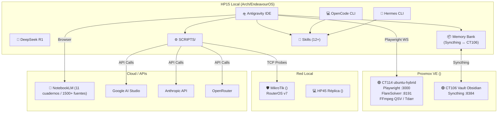

# Skill: Opti-Floydia & Ecosystem SRE Governor v4.0 (`f-opti-floydia`)

> **Propósito**: Convierte al agente en un **SRE Governor autónomo y seguro** del ecosistema FloydIA, capaz de auditar hardware, red, Proxmox, MikroTik, agentes, cuellos de botella del sistema, generar Prompts Duales para análisis en IAs Web externas, crear mapas mentales del ecosistema y aplicar optimizaciones no invasivas sin riesgo de congelamientos.

---

## 🎯 1. Menú Interactivo Menu-First

Al invocar `/f-opti`, `/opti`, `/opti-floydia` o al solicitar auditar el ecosistema, el agente **DEBE responder de inmediato presentando este menú interactivo**:

```markdown
╔═══════════════════════════════════════════════════════════════╗
║       🛰️ OPTI-FLOYDIA — ECOSYSTEM SRE GOVERNOR v4.1           ║
╚═══════════════════════════════════════════════════════════════╝

Selecciona una acción respondiendo con el **número** correspondiente:

1️⃣ **Diagnóstico Completo del Ecosistema**
   ↳ Sonda `ecosystem_probe.py`: HP15 (CPU, RAM, ZRAM, PSI, Load), HP45, MikroTik
     (), Proxmox (), CT114 Playwright (:3000), CT106 (:8384),
     MCPs, Token Budget + estado de BACKUP (último manifest SHA256), HEARTBEATS y LOGS
     de `guard_command`.

2️⃣ **Generar Prompts Duales para IA Web (Claude Web / ChatGPT)**
   ↳ 2 prompts sanitizados **según Clasificación de Egreso §5** (`agents-overlay.md`):
     • Prompt A (Telemetría & Diagnóstico Profundo) — solo datos PÚBLICO/INTERNO
     • Prompt B (Plan de Acción & Decisiones SRE, matriz Impacto vs Riesgo y rollback)
   PROHIBIDO enviar datos CLIENTE/CONFIDENCIAL o SECRETO (usar variante sanitizada).

3️⃣ **Optimización Rápida (Quick Wins Seguras)**
   ↳ Saneamiento seguro de temporales, purga de procesos zombis desvinculados y
     validación de memoria sin reiniciar el sistema.

4️⃣ **Consultar Ground Truth (Graphify por lotes + NotebookLM + Obsidian)**
   ↳ `SCRIPTS/graphify_query.sh "<término>" <dominio>` — INDEXACIÓN POR LOTES (~1s)
     con fallback al índice raíz; + `lessons-learned.md`, `techContext.md` y cuadernos
     LINUX_PROXMOX / PROMPT_ENGINEERING.

5️⃣ **Auditoría de Red, MikroTik & APIs de IA**
   ↳ Mide latencias TCP hacia Proxmox CT114 (Playwright WS), CT106, RouterOS y
     resolución DNS de Google AI, Anthropic y OpenRouter.

6️⃣ **Rescate de Emergencia Anti-Hang (< 1s)**
   ↳ `SCRIPTS/kill_hung_agents.sh` con lista blanca estricta, sin tocar IDE/LSPs.

7️⃣ **🔍 Diagnóstico de Cuellos de Botella & Errores del Sistema**
   ↳ dmesg, I/O wait %, thermal throttling, OOM events, ZRAM compression, PSI, disco.

8️⃣ **🛸 Auditoría de Agentes & Harness Engineering**
   ↳ Salud de Antigravity, OpenCode, Codex CLI, Hermes, DeepSeek; verifica symlinks
     `f-*` en `.agents/`, `~/.opencode/`, `~/.codex/`, `~/.hermes/`; MCPs, logs y
     flujo Líder→Explorador→Implementador→Revisor.

9️⃣ **🗺️ Mapa Mental / Infograma del Ecosistema**
   ↳ Mermaid completo de HP15 ↔ Proxmox ↔ Red ↔ Cloud + prompt para infograma visual
     premium (sanitizado).

🔟 **📜 Escaneo de Prompts Históricos & Enriquecimiento**
   ↳ Inventario de `memory-bank/prompts/`, cobertura CAT_01..08, patrones y lagunas.

1️⃣1️⃣ **🛡️ Resiliencia & Continuidad (SRE)**
   ↳ Verifica backup del ecosistema (`backup_ecosistema.sh`: manifest SHA256 + log OK
     + heartbeat) · estado de `guard_command.py` (denylist) · `check_heartbeats.py`
     (ALERT de crons muertos) · prueba de restauración en `scratch/` (age -d + tar -t).

1️⃣2️⃣ **🐝 Enjambre Multiconsulta SRE (Consenso 5 Motores a $0.00)**
   ↳ Somete anomalías complejas de telemetría y propuestas de cambio a deliberación simultánea
     de los 5 motores (Kimi K3, DeepSeek-R1, Gemini 3.8 Flash, Qwen 2.5 Coder y AGY). Emite
     matriz de consenso técnico, mitigación de riesgos y plan de rollback garantizado.

0️⃣ **Salir**
```

---

## 🛡️ 2. Principios de Diseño y Guardrails Inmutables

1. **P1 — Read-First & Observabilidad**: Siempre ejecutar `ecosystem_probe.py` antes de proponer cualquier cambio.
2. **P2 — Fail-Closed & Zero Destructive**: Ante cualquier error o duda, el sistema no se modifica.
3. **P3 — Prohibición de `sync` Global**: Prohibido invocar `sync` en carpetas sincronizadas (Dropbox/Syncthing) para evitar I/O stalls en Xorg/Electron.
4. **P4 — Protección de Procesos Críticos (Lista Blanca Estricta)**: Nunca terminar procesos de Antigravity IDE, LSPs (`jedi`, `tsserver`), Syncthing ni demonios de sistema.
5. **P5 — Hardening de Python**: Todo script se ejecuta con `SCRIPTS/safe_run_python.sh` (timeout duro, `stdin` a `/dev/null` y `nice -n 10`).
6. **P6 — Sanitización de Secretos**: Ningún prompt, log o reporte debe exponer claves o tokens del `.env`; usar siempre `${VARIABLE}` o `[REDACTED]`.
7. **P7 — Clasificación de Egreso (§5 agents-overlay.md, 2026-09-01)**: Los Prompts Duales deben clasificar los datos (PÚBLICO/INTERNO/CLIENTE/CONFIDENCIAL/SECRETO); datos CLIENTE o SECRETO JAMÁS salen del entorno. En duda → clase superior, no enviar.
8. **P8 — Certificación sin artefacto (2026-09-01)**: Prohibido declarar "backup OK" o "enforcement activo" sin cita del manifest `.sha256` (suma coincide), entrada `OK` en log y heartbeat correspondiente; idem Regla del Único Certificador del workspace.

---

## 📦 3. Herramientas y Scripts de la Skill

| Script / Comando | Función | Modo |
|---|---|:---:|
| `.agents/skills/f-opti-floydia/scripts/ecosystem_probe.py` | Sonda de telemetría completa (Markdown o `--json`) | Read-Only |
| `.agents/skills/f-opti-floydia/scripts/dual_prompt_generator.py` | Generador de Prompts A y B para Claude / ChatGPT Web | Generativo |
| `.agents/skills/f-opti-floydia/scripts/bottleneck_analyzer.py` | Diagnóstico de cuellos de botella, errores kernel y throttling | Read-Only |
| `.agents/skills/f-opti-floydia/scripts/agent_health_check.py` | Auditoría de agentes, symlinks, MCPs y harness | Read-Only |
| `SCRIPTS/safe_run_python.sh` | Wrapper universal de ejecución aislada con timeout | Guardrail |
| `SCRIPTS/kill_hung_agents.sh` | Rescate en caliente seguro sin reiniciar la PC | Rescate |
| `SCRIPTS/antigravity_speed_boost.sh` | Saneador de temporales y registro MCP | Saneamiento |
| `SCRIPTS/verify_multiagent_parity.py` | Certificación de paridad de skills entre agentes | Auditoría |
| `SCRIPTS/notebooklm_curator.py` | Enrutamiento y consulta de cuadernos NLM | Consulta |
| `SCRIPTS/graphify_query.sh` | Wrapper de `graphify query` con índice por dominio (lotes) + fallback | Consulta |
| `SCRIPTS/backup_ecosistema.sh` | Backup cifrado (age) del ecosistema → BACKUP_MEM_ENV (o NAS si >5GB) | Resiliencia |
| `SCRIPTS/guard_command.py` | Denylist mecánica de comandos destructivos (rm -rf, dd, force-push…) | Enforcement |
| `SCRIPTS/check_heartbeats.py` | Detecta crons muertos en silencio (ALERT_CRONS_MUERTOS) | Monitoreo |

---

## 🚀 4. Guía de Ejecución por Opción

### Opciones 1–6: Ejecución Directa (scripts existentes)
```bash
# Opción 1: Telemetría completa
python3 .agents/skills/f-opti-floydia/scripts/ecosystem_probe.py

# Opción 2: Prompts Duales para Claude/ChatGPT
python3 .agents/skills/f-opti-floydia/scripts/dual_prompt_generator.py

# Opción 3: Saneamiento seguro
./SCRIPTS/antigravity_speed_boost.sh --apply --clean-tmp --kill-duplicates

# Opción 6: Rescate Anti-Hang
./SCRIPTS/kill_hung_agents.sh
```

### Opción 11: 🛡️ Resiliencia & Continuidad (SRE)

**Pipeline obligatorio:**

1. **Verificar el último backup del ecosistema** (P8 — no certificar sin artefacto):
```bash
ls -la /Dropbox/BACKUP_MEM_ENV/                    # alternativo: /mnt/nas/BACKUP_MEM_ENV
cd /Dropbox/BACKUP_MEM_ENV && sha256sum -c *.sha256   # debe decir "La suma coincide"
tail -2 /SCRIPTS/logs/backup_ecosistema.log  # línea "OK"
ls -la /.cache/cron_heartbeats/backup_ecosistema       # heartbeat presente
# un .age SIN su .sha256 = backup parcial → NO certificar y borrar
```

2. **Prueba de restauración** (no destructiva, en scratch/):
```bash
mkdir -p /scratch/restore_probe
ls -1 /Dropbox/BACKUP_MEM_ENV/eco_backup_*.tar.gz.age | head -1 | \
  xargs -I{} age -d -i /.secrets/age.key {} | tar -tzf - | head -20
# Lista contenidos SIN extraer: verifica integridad del archivo cifrado sin escribir nada en el workspace
```

3. **Estado del enforcement mecánico**:
```bash
echo 'echo test_safe' | python3 /SCRIPTS/guard_command.py && echo "guard PERMITE seguro"
echo 'rm -rf ./fake_destructive_path' | python3 /SCRIPTS/guard_command.py ; echo "guard BLOQUEA destructivo (exit=$?)"
tail -5 /SCRIPTS/logs/guard_command.log 2>/dev/null
```

4. **Heartbeats de crons**:
```bash
python3 /SCRIPTS/check_heartbeats.py; echo "exit=$?"
cat /.cache/cron_heartbeats/ALERT_CRONS_MUERTOS 2>/dev/null || echo "sin alertas activas"
```

5. **Reporte estructurado** (tabla): componente | estado | evidencia (ruta/comando) | severidad:

| Componente | Estado | Evidencia |
|---|---|---|
| Backup ecosistema | 🟢/🔴 | manifest + log + heartbeat |
| Integridad cifrado | 🟢/🔴 | `age -d \| tar -t` |
| guard_command | 🟢/🔴 | test bloqueo/permitir + log |
| Cron heartbeats | 🟢/🔴 | check_heartbeats exit + ALERT |

### Opción 7: 🔍 Diagnóstico de Cuellos de Botella & Errores

**Pipeline obligatorio:**

1. **Ejecutar `bottleneck_analyzer.py`**:
```bash
python3 .agents/skills/f-opti-floydia/scripts/bottleneck_analyzer.py
python3 .agents/skills/f-opti-floydia/scripts/bottleneck_analyzer.py --json  # Para procesamiento automatizado
```

2. **Análisis complementario manual** (si el script detecta anomalías):
```bash
# Errores recientes del kernel (últimas 200 líneas)
dmesg --level=err,warn | tail -200

# I/O Wait actual (5 muestras de 1 segundo)
iostat -x 1 5 2>/dev/null || sar -d 1 5 2>/dev/null

# Procesos zombie
ps aux | awk '$8 ~ /Z/ {print}'

# Top procesos por CPU y memoria
ps aux --sort=-%cpu | head -15
ps aux --sort=-%mem | head -15

# Thermal throttling (si hay sensores)
sensors 2>/dev/null | grep -i "temp\|critical\|high"

# Estado de ZRAM
cat /proc/swaps && zramctl 2>/dev/null
```

3. **Reporte estructurado**: Genera tabla con severidad (🔴 Crítico / 🟡 Advertencia / 🟢 OK) por cada categoría:
   - Errores de Kernel / dmesg
   - I/O Wait y latencia de disco
   - Presión de memoria (PSI) y OOM events
   - Thermal throttling y frecuencia de CPU
   - Procesos zombie y huérfanos
   - ZRAM compression ratio y eficiencia
   - Xorg / Wayland hangs o errores gráficos

### Opción 8: 🛸 Auditoría de Agentes & Harness Engineering

**Pipeline obligatorio:**

1. **Ejecutar `agent_health_check.py`**:
```bash
python3 .agents/skills/f-opti-floydia/scripts/agent_health_check.py
python3 .agents/skills/f-opti-floydia/scripts/agent_health_check.py --json
```

2. **Verificación de paridad multi-agente**:
```bash
python3 SCRIPTS/verify_multiagent_parity.py
```

3. **Análisis complementario**:
```bash
# Procesos de agentes activos y sus consumos
ps aux | grep -E '(hermes|opencode|antigravity|gemini|deepseek|claude)' | grep -v grep | \
  awk '{printf "%-10s PID:%-6s CPU:%-5s MEM:%-5s CMD:%s\n", $1, $2, $3, $4, $11}'

# Symlinks de skills (verificar integridad en TODOS los agentes: Antigravity/, OpenCode, Codex, Hermes)
find /skills/ -type l -exec sh -c 'test -e "$1" || echo "ROTO: $1"' _ {} \;
find /skills/ -type l -exec sh -c 'test -e "$1" || echo "ROTO: $1"' _ {} \;
find /skills/ -type l -exec sh -c 'test -e "$1" || echo "ROTO: $1"' _ {} \; 2>/dev/null
find /.agents/skills/ -maxdepth 1 -type d -name 'f-*' | wc -l

# MCPs activos en configuración
python3 -c "import json; d=json.load(open('/.gemini/config/mcp_config.json')); print(f'MCPs configurados: {len(d.get(\"mcpServers\",{}))}'); [print(f'  - {k}') for k in d.get('mcpServers',{})]" 2>/dev/null

# Logs recientes de errores de agentes
journalctl --user -p err --since "1 hour ago" --no-pager 2>/dev/null | tail -30
```

4. **Reporte estructurado**: Genera tabla por agente:

| Agente | Proceso | CPU% | MEM% | Skills | Symlinks | MCPs | Estado |
|---|---|---|---|---|---|---|---|
| Antigravity IDE | PID/Activo/Inactivo | X% | X% | N/N | ✅/❌ | N activos | 🟢/🔴 |
| OpenCode CLI | ... | ... | ... | ... | ... | ... | ... |
| Hermes CLI | ... | ... | ... | ... | ... | ... | ... |
| DeepSeek | ... | ... | ... | ... | ... | ... | ... |

5. **Diagnóstico de Harness Workflow**: Verificar si `SCRIPTS/init_harness.sh` existe y es ejecutable, si hay arneses activos en `brain/`, y el estado del flujo Líder→Explorador→Implementador→Revisor.

### Opción 9: 🗺️ Mapa Mental / Infograma del Ecosistema

**Pipeline obligatorio:**

1. **Generar diagrama Mermaid** del ecosistema completo:



2. **Generar prompt para NotebookLM / Claude Web** que cree un infograma visual premium del ecosistema (sanitizado, sin secretos).

3. **Prompt de infograma** — el agente genera un prompt detallado listo para copiar a una IA generativa de imágenes o a NotebookLM que describa todos los nodos, conexiones, servicios, puertos y flujos de datos del ecosistema FloydIA.

### Opción 10: 📜 Escaneo de Prompts Históricos & Enriquecimiento

**Pipeline obligatorio:**

1. **Inventario de archivos de prompts**:
```bash
ls -la memory-bank/prompts/*.md | awk '{print $5, $9}' | sort -rn
wc -l memory-bank/prompts/*.md | sort -rn | head -30
```

2. **Análisis de cobertura** — verificar que cada categoría `CAT_01..08` tiene:
   - Prompt patrón correspondiente (`P01..P06`)
   - Entrada en `CATALOGO_HISTORICO_PROMPTS_OPTIMIZADOS.md`
   - Suite de verificación si aplica

3. **Detección de patrones recurrentes**: Buscar con `rg` las técnicas más usadas:
```bash
rg -c "XML\b|<system>|<context>|<rules>" memory-bank/prompts/ --sort path
rg -c "Few-Shot|Chain-of-Thought|CoT|Zero-Shot" memory-bank/prompts/ --sort path
rg -c "LRM\b|Thinking\b|Razonamiento" memory-bank/prompts/ --sort path
```

4. **Detección de lagunas**: Identificar categorías sin cobertura, prompts obsoletos (>30 días sin actualizar) y oportunidades de mejora.

5. **Recomendaciones de enriquecimiento**: Generar lista accionable de mejoras para:
   - Skills que podrían beneficiarse de más prompts patrón
   - Cuadernos de NotebookLM que necesitan fuentes nuevas
   - Plantillas XML que podrían estandarizarse

---

## 🔄 5. Compatibilidad Multi-Agente

| Agente | Soporte | Notas |
|---|:---:|---|
| **Antigravity IDE** | ✅ Completo | Menú interactivo, browser, subagentes, Mermaid rendering |
| **OpenCode CLI** | ✅ Completo | Menú en texto, ejecución de scripts de sonda y análisis |
| **Hermes CLI** | ✅ Completo | Menú en texto, ejecución de scripts de sonda y análisis |
| **Modo Degradado** | — | Si `ecosystem_probe.py` falla, ejecutar comandos manuales individuales |
