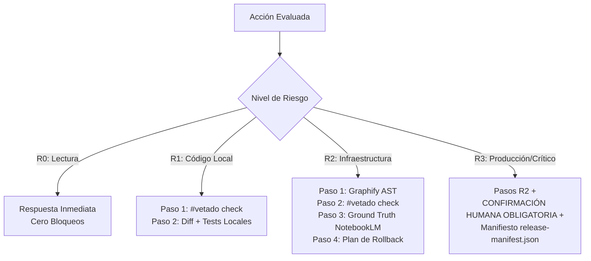

# Skill: Central Policy Engine FloydIA (`f-policy-engine` v1.0)
## Security Kernel & Governance Plane

> **Propósito**: Actuar como el **núcleo de seguridad y gobernanza** de todo el ecosistema. Centraliza la validación de comandos contra la denylist global de acciones destructivas, la redacción mecánica de secretos en textos y logs, y la auditoría de los requisitos del Protocolo v28 para cualquier tarea.

---

## 🎯 1. Capacidades Operativas Centralizadas

```bash
# 1. Comprobar si un comando CLI es seguro o destructivo
python3 SCRIPTS/policy_engine.py --check-command "rm -rf ./directorio_inseguro"

# 2. Evaluar nivel de riesgo R0-R3 y requisitos obligatorios
python3 SCRIPTS/policy_engine.py --eval-risk "modificar contenedor en proxmox ct114"

# 3. Sanitizar un bloque de texto reemplazando valores de .env por [REDACTED]
python3 SCRIPTS/policy_engine.py --redact-secrets "mi token es sk-ant-api..."
```

---

## 🛡️ 2. Denylist Inmutable de Comandos Bloqueados

El `policy_engine.py` bloquea por defecto (`exit 1`):
1. Borrado recursivo forzado fuera de `/tmp/` o `scratch/`.
2. Escrituras destructivas de bajo nivel en bloques de disco.
3. Formateo y eliminación de tablas de particiones.
4. Force-push destructivo en Git (`git push --force`, `git push -f`).
5. Destrucción de bases de datos (`DROP TABLE`, `TRUNCATE TABLE`).
6. Invocación global de `sync` en carpetas compartidas con Dropbox/Syncthing (#vetado por congelamiento de I/O en Xorg).

---

## 🔒 3. Matriz de Requisitos por Nivel de Riesgo (Protocolo v28)



---

## 🔄 4. Compatibilidad Multi-Agente

| Agente | Soporte | Notas |
|---|:---:|---|
| **Antigravity IDE** | ✅ Completo | Comprobación de seguridad previa a tool calls de terminal |
| **OpenCode CLI** | ✅ Completo | `policy_engine.py` como wrapper de comandos en bash |
| **DeepSeek Harness** | ✅ Completo | Enforcement de denylist y redacción de secretos |
| **Hermes CLI** | ✅ Completo | Validación determinista de riesgo |
