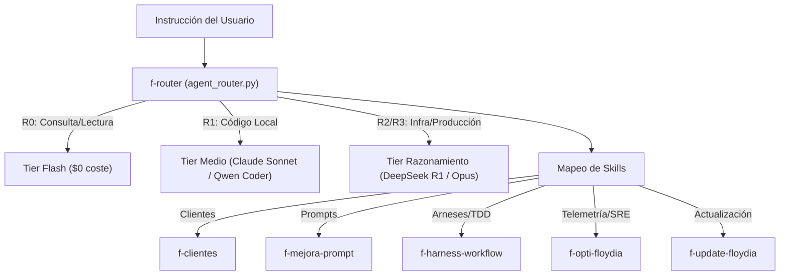

# Skill: Despachador Universal FloydIA Agent OS (`f-router` v1.0)
## Core Governor & Context Routing Plane

> **Propósito**: Eliminar la necesidad de que el usuario recuerde comandos manuales para cada tarea. `f-router` actúa como el **despachador central** del ecosistema: recibe una instrucción en lenguaje natural, clasifica el proyecto y su nivel de riesgo bajo el Protocolo v28, define las skills a involucrar y entrega la ruta de ejecución óptima.

---

## 🎯 1. Comportamiento y Despacho Automático

Al invocar `/f-router <instrucción>` o recibir una directiva de trabajo compleja, el agente ejecuta:

```bash
python3 SCRIPTS/agent_router.py "<instrucción del usuario>"
```

### Formato de Salida Contractual

```yaml
task_dispatch:
  query: "<instrucción del usuario>"
  classification:
    domain: "CLIENTES | FLOYDIA | HARDWARE_IoT | INFRAESTRUCTURA | VARIOS"
    project: "PROJECT_ALPHA | PROJECT_BETA | PROJECT_DELTA | PROJECT_GAMMA | ..."
    risk_level: "R0 | R1 | R2 | R3"
  orchestration:
    skills:
      - "f-clientes"
      - "f-harness-workflow"
    model_tier: "flash/lite | medio/frontier | razonamiento"
    swarm_consenso: "true | false (Enjambre 5 motores a $0.00 para arbitraje de intención compleja)"
    context_paths:
      - "CLIENTES/<PROYECTO>/DRIVE/..."
```

### 🐝 Submodo Enjambre Multiconsulta (Arbitraje Colegiado 5 Motores)
Si se incluye el flag `--enjambre` o la petición presenta conflicto de dominios, `f-router` despacha la clasificación a los 5 motores (Kimi K3, DeepSeek-R1, Gemini 3.8 Flash, Qwen 2.5 Coder y AGY/Local), promediando las puntuaciones de riesgo y fijando la ruta por consenso mayoritario.

---

## 🧭 2. Matriz de Enrutamiento Inmediato



---

## 🛡️ 3. Reglas de Gobernanza Vinculadas

1. **Riesgo R0 (Lectura):** Despacho inmediato sin compuertas de bloqueo.
2. **Riesgo R1 (Código Local):** Activación de `lessons-learned.md` (#vetado) + red de seguridad git.
3. **Riesgo R2 (Infraestructura / Servicios):** Activación de Graphify AST + Ground Truth NotebookLM + plan de rollback.
4. **Riesgo R3 (Producción / Comandos Críticos):** **Detención obligatoria** solicitando confirmación humana explícita antes de ejecutar cualquier acción destructiva.

---

## 🔄 4. Compatibilidad Multi-Agente

| Agente | Soporte | Notas |
|---|:---:|---|
| **Antigravity IDE** | ✅ Completo | Inferencia directa y generación de plan de vuelo |
| **OpenCode CLI** | ✅ Completo | `python3 SCRIPTS/agent_router.py "<query>"` |
| **DeepSeek Harness** | ✅ Completo | Configuración de perfiles según el tier inferido |
| **Hermes CLI** | ✅ Completo | Despacho CLI en texto plano |
