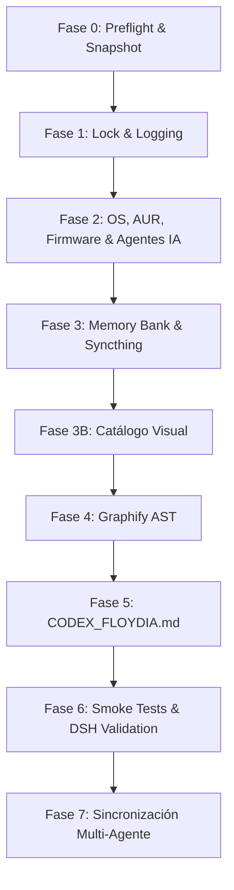

# Skill: Suite de Actualización & Disaster Recovery (`f-update-floydia` v5.3)

> **Propósito**: Proveer un pipeline determinista y verificable para el mantenimiento integral del ecosistema FloydIA (Host HP15, Proxmox CT106/CT114, MikroTik y Réplica HP45), indexación semántica de activos visuales y regeneración de `CODEX_FLOYDIA.md`.

---

## 🎯 1. Menú Interactivo Menu-First

Al invocar `/f-update`, `/update` o solicitar actualizar el sistema o imágenes, el agente **DEBE responder presentando este menú**:

```markdown
╔═══════════════════════════════════════════════════════════════╗
║         🚀 F-UPDATE-FLOYDIA — SOVEREIGN SYNC & RECOVERY       ║
╚═══════════════════════════════════════════════════════════════╝

Selecciona una acción respondiendo con el **número** correspondiente:

1️⃣ **Actualización Completa (Full Pipeline Fases 0 a 7)**
   ↳ Ejecuta Preflight, Sistema OS/AUR/NPM (DeepSeek Harness, OpenCode, Antigravity), Memory Bank, Catálogo Visual de Imágenes, Graphify AST, CODEX_FLOYDIA.md, Smoke Tests y Sincronización Multi-Agente.

2️⃣ **Catálogo Visual & Metadatos Semánticos de Imágenes** 📸
   ↳ Ejecuta `index_workspace_images.py` en paralelo. Extrae dimensiones, DPI, ratios, tipo MIME, hash SHA256 y genera descripciones semánticas completas y textos ALT. Actualiza `IMAGE_KNOWLEDGE_GRAPH_WORKSPACE.json` e `IMAGE_CATALOG.md`.

3️⃣ **Compactación del Memory Bank & Auditoría Syncthing**
   ↳ Ejecuta `memory_compactor.py` bajo lock exclusivo, valida token budget (`activeContext.md` ≤ 400 tokens) y audita `.sync-conflict`.

4️⃣ **Auditoría de Sistema, Paquetes & Agentes IA (Arch / AUR / Flatpak / DSH / OpenCode)**
   ↳ Verifica mirrors (`reflector`), detecta actualizaciones con `checkupdates`, `yay -Qua`, audita paquetes NPM globales y diagnostica firmware sin cambios destructivos.

5️⃣ **Reconstrucción del Grafo AST (Graphify) & Manifiesto CODEX**
   ↳ Reconstruye el grafo relacional de código y notas, y actualiza el manifiesto bare-metal `CODEX_FLOYDIA.md`.

6️⃣ **Smoke Tests & Certificación Rápida**
   ↳ Ejecuta `pacman -Dk`, validación de perfiles Cordis de DeepSeek Harness (`dsh`), consultas de baja latencia a Graphify (<10ms) y verificación de consistencia.

7️⃣ **Sincronización Multi-Agente (OpenCode Desktop, DeepSeek Harness)**
   ↳ Ejecuta `sync_skills_multiagent.sh --fix` para sincronizar skills `f-*`, symlinks `AGENTS.md` y perfiles de DeepSeek Harness.

0️⃣ **Salir**
```

---

## ⚡ 2. Modos de Ejecución y Flags CLI (`SCRIPTS/update_floydia.py`)

```bash
# Simulación no destructiva (Dry-Run)
python3 SCRIPTS/update_floydia.py --full --dry-run --verbose

# Ejecución real autorizando actualización de paquetes y agentes
python3 SCRIPTS/update_floydia.py --full --yes --verbose

# Módulos específicos
python3 SCRIPTS/update_floydia.py --system --dry-run   # OS, AUR, Flatpaks, Firmware, NPM Agents (DSH, OpenCode)
python3 SCRIPTS/update_floydia.py --images             # Solo Catálogo Visual & Metadatos Semánticos
python3 SCRIPTS/update_floydia.py --memory            # Solo Memory Bank y Syncthing
python3 SCRIPTS/update_floydia.py --graph             # Solo Graphify AST
python3 SCRIPTS/update_floydia.py --codex             # Solo CODEX_FLOYDIA.md
python3 SCRIPTS/update_floydia.py --verify            # Solo smoke tests y validación DSH
```

---

## 📋 3. Pipeline de Ejecución de 8 Fases



1. **Fase 0 (Preflight)**: Introspección de Host HP15, permisos `chmod 600` en `/.secrets/antigravity.env`, conectividad LAN (CT106, CT114, MikroTik), y verificación mandatoria del último backup del ecosistema (`sha256sum -c *.sha256` en `BACKUP_MEM_ENV` y heartbeat activo de `backup_ecosistema`).
2. **Fase 1 (Control)**: Lock exclusivo `fcntl.flock` sobre `/tmp/update_floydia.lock` y logging JSONL.
3. **Fase 2 (Sistema & Agentes)**: Mirrorlist HTTPS, `checkupdates`, `yay -Syu --noconfirm` (solo con `--yes`), Flatpaks, `fwupdmgr` y auditoría de agentes NPM (`@deepseek-ai/dsh`, `opencode-ai`).
4. **Fase 3 (Memoria)**: `memory_compactor.py`, `boot_budget_check.py` (`activeContext.md` ≤ 400 tokens) y escaneo de `.sync-conflict` (prohibido borrarlos en automático).
5. **Fase 3B (Imágenes)**: `index_workspace_images.py` en paralelo para conocimiento multimodal.
6. **Fase 4 (Graphify)**: Reconstrucción del grafo relacional `graphify update .`.
7. **Fase 5 (CODEX)**: Actualización determinista del blueprint bare-metal `CODEX_FLOYDIA.md` (8 Fases).
8. **Fase 6 (Smoke Tests & DSH)**: `pacman -Dk`, validación de configuración `dsh --profile web --dump-config`, consulta Graphify (<10ms) y reporte contractual.
9. **Fase 7 (Sincronización Multi-Agente)**: Ejecución de `sync_skills_multiagent.sh --fix` asegurando paridad del 100% en Antigravity, OpenCode Desktop y DeepSeek Harness.

---

## 🔒 4. Guardrails y troubleshooting

1. **Zero-Leak**: Toda credencial se enmascara `[REDACTED]`.
2. **Non-Destructive**: Comandos destructivos requieren `--yes`.
3. **Permisos de Secretos**: Si `antigravity.env` != 600 ➔ ejecutar `chmod 600 /.secrets/antigravity.env`.
4. **Token Budget Excedido**: Si `activeContext.md` > 400 tokens ➔ ejecutar `python3 SCRIPTS/boot_budget_check.py --fix`.
5. **Configuración DSH**: Si `dsh --profile web --dump-config` falla ➔ verificar `~/.dsh/profiles/web/cordis.patch.yml` contra la plantilla en `SCRIPTS/setup_dsh_hp45.sh`.

---

## 🔗 5. Fase 7: Sincronización de Skills Multi-Agente

Tras completar las fases 0-6, ejecutar automáticamente:
```bash
# Sincronizar skills f-* y configuraciones hacia OpenCode y DeepSeek Harness
bash SCRIPTS/sync_skills_multiagent.sh --fix
```

Esta fase garantiza que los 8 skills canónicos `f-*` y el enlace `AGENTS.md` estén disponibles como symlinks funcionales en la trinidad agéntica oficial (Antigravity, OpenCode Desktop, DeepSeek Harness).

---

## 🔄 6. Compatibilidad Multi-Agente

| Agente | Soporte | Notas |
|---|:---:|---|
| **Antigravity IDE** | ✅ Completo (Nativo) | Menú interactivo, todas las fases y herramientas nativas (.agents/skills) |
| **OpenCode Desktop / CLI** | ✅ Completo | Menú en texto, ejecución de `update_floydia.py` y symlinks de skills `f-*` |
| **DeepSeek Harness (`dsh`)** | ✅ Completo | Perfiles Web Cordis, symlink `AGENTS.md`, validación `dump-config` |
| **Modo Degradado** | — | Ejecutar fases individuales con flags CLI (`--system`, `--memory`, `--verify`, etc.) |
